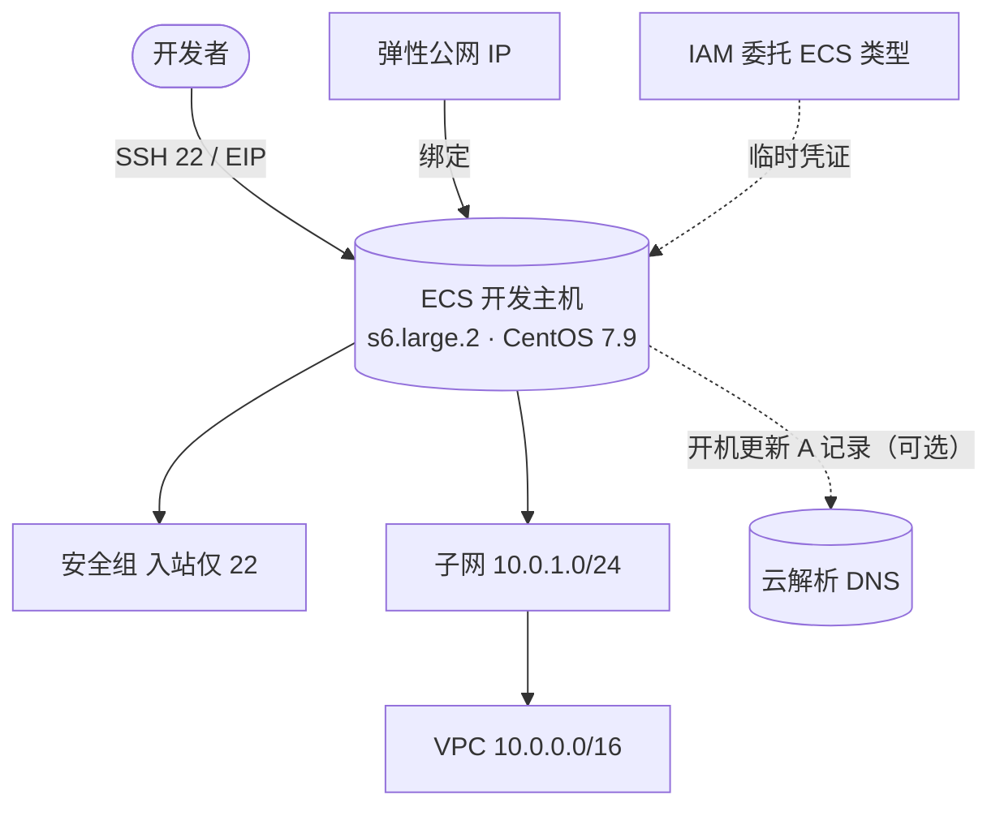

# distributed-x-infrastructure-single-dev-ecs · 单一 ECS 开发主机 · 华为云实践


## 1. 简介 / Overview

### 简介


一套在华为云上**按需创建、可随时启停与重建**的单台 ECS 开发主机最佳实践。用 Terraform 一键拉起固定规格的 ECS，预装 Git、Node（nvm）、Python 与华为云 SDK；不用时 `stop` 停机，彻底不用时 `destroy` 释放。适用于需要「干净 Linux 盒子」做验证、构建、学习的工程师与团队。

---

## 2. 目录

- [1. 简介 / Overview](#1-简介--overview)
- [2. 目录](#2-目录)
- [3. 架构图](#3-架构图)
- [4. 方案亮点](#4-方案亮点)
- [5. 涉及云服务](#5-涉及云服务)
- [6. 前置条件](#6-前置条件)
- [7. 快速开始](#7-快速开始)
- [8. 分步部署](#8-分步部署)
- [9. 使用方法 / 验证](#9-使用方法--验证)
- [10. 清理资源](#10-清理资源)
- [11. 详细说明](#11-详细说明)
- [12. 依赖](#12-依赖)
- [13. FAQ / 故障排除](#13-faq--故障排除)
- [14. 贡献指南](#14-贡献指南)
- [15. 许可证](#15-许可证)
- [16. 联系方式 / 维护者](#16-联系方式--维护者)

---

## 3. 架构图



---

## 4. 方案亮点

- **一键 IaC**：Terraform 声明式管理，重复创建「干净环境」零手工。
- **成本可控**：不用即 `stop`/`destroy`，最小规格开销极低。
- **安全接入**：密钥对 + 安全组（SSH 仅 22），凭据仅环境变量提供，不落盘。
- **可选 DNS**：启用后 ECS 每次开机自动把 EIP 写入云解析 A 记录。

---

## 5. 涉及云服务

- ECS（弹性云服务器）
- VPC（虚拟私有云）
- EIP（弹性公网 IP）
- IAM（统一身份认证）
- 云解析 DNS（可选）

---

## 6. 前置条件

- 华为云账号，具备 VPC / ECS / EIP / 密钥对 /（可选）DNS 创建权限。
- 本地安装 [Terraform](https://www.terraform.io/downloads) ≥ 1.5、Python ≥ 3.7。
- 配置凭据（仅环境变量，不落盘）：
```bash
export HW_ACCESS_KEY="<HW_ACCESS_KEY>"
export HW_SECRET_KEY="<HW_SECRET_KEY>"
```
- 已准备 SSH 公钥（如 `~/.ssh/id_rsa.pub`）。

---

## 7. 快速开始

```bash
cd infra
cp terraform.tfvars.example terraform.tfvars # 按需修改（建议 public_key 用命令行注入）
terraform init
terraform apply -var="public_key=$(cat ~/.ssh/id_rsa.pub)"
terraform output ssh_command # 取得连接串
```

---

## 8. 分步部署

1. 复制 `terraform.tfvars.example` 为 `terraform.tfvars`。
2. 准备 SSH 公钥，建议用变量注入。
3. 执行 `terraform init` 初始化 provider。
4. 执行 `terraform apply` 部署。
5. 通过 `terraform output ssh_command` 取得连接串。
6. 验证 SSH 登录、Node/nvm/Git 可用。

---

## 9. 使用方法 / 验证

### 使用方法与验证

通过 `terraform output` 取得 SSH 连接串，使用 `src/scripts/ecs` 脚本完成启停与状态查看，详见下列步骤。

```bash
# 生成 outputs.json 供运维脚本使用
terraform output -json > src/outputs.json
cp src/configs/config.json.example src/configs/config.json
pip install -r src/scripts/requirements.txt

# 启停与状态
python src/scripts/ecs status
python src/scripts/ecs stop # 停机
python src/scripts/ecs start

# 写入 ~/.ssh/config 后直接 ssh <nick_name>
python src/scripts/setssh
ssh <nick_name>
```

验证成功标志：SSH 可登录；`node -v` / `nvm -v` / `git --version` 可用；启用 DNS 时 `dig +short <ecs_name>.<domain>` 解析到 EIP。

部署完成后请按本节步骤自行验证，确认业务功能可用，方可视为交付完成。

---

## 10. 清理资源

```bash
terraform destroy
# 并 API 直查确认无残留（EIP / ECS / 孤立云硬盘等）
```

---

## 11. 详细说明

- 架构与资源：见 [docs/architecture.md](docs/architecture.md)
- 部署步骤：见 [docs/deployment-guide.md](docs/deployment-guide.md)

---

## 12. 依赖

- 华为云 Terraform Provider (`huaweicloud`)
- 华为云原生服务：ECS / VPC / EIP / IAM / 云解析 DNS

---

## 13. FAQ / 故障排除

### FAQ

- **SSH 连不上**：确认 `ssh_allowed_cidr` 是否收敛到了非本机 IP；ECS 重启后 EIP 不变，若报主机密钥变更先 `ssh-keygen -R <ip>`。
- **镜像找不到**：目标 region 无 `CentOS 7.9 64bit` 时，改 `image_name` 变量（如 `Huawei Cloud EulerOS 2.0 64bit`）。
- **DNS 不生效**：确认 `account_domain`（IAM 账号域名）正确、`dns_zone_id` 已填、ECS 已绑定委托；手动跑 `python3 /var/lib/cloud/scripts/per-boot/set-dns` 看输出。

---

## 14. 贡献指南

欢迎提交 Issue 与 PR。请遵循仓库内现有目录结构与代码风格。

---

## 15. 许可证

本实践采用 **MIT No Attribution** 许可证，详见仓库根目录 [`LICENSE`](LICENSE) 文件。


本实践以 **MIT-0** 许可证发布。详见 [LICENSE](LICENSE)。

---

## 16. 联系方式 / 维护者
| 项 | 内容 |
|---|---|
| **创建者** | [dgc-git](https://github.com/dgc-git) |
| **维护者** | [dgc-git](https://github.com/dgc-git) |
| **联系方式** | GitHub Issues / PR（见[第 14 节](#14-贡献指南)） |
