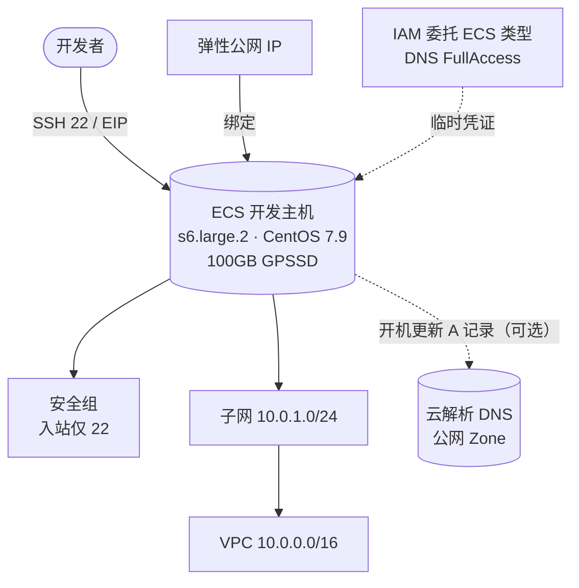

# 单一 ECS 开发主机 · 华为云架构说明

> 一套在华为云上按需创建、可随时启停与重建的单台 ECS 开发主机最佳实践，预装常用开发工具链，通过密钥对与安全组实现安全接入。

## 1. 概述

本实践解决「随时需要一台干净 Linux 盒子做验证 / 构建 / 学习」的诉求：用 Terraform 一键拉起一台固定规格的 ECS，预装 Git、Node（nvm）、Python 与华为云 SDK；不用时可 `stop` 停机，彻底不用时 `destroy` 释放。整个环境基于华为云原生产品构建。

适用人群：需要可复现开发 / 验证环境的工程师；希望用 IaC 管理「临时云主机」的团队。

## 2. 架构图

## 3. 资源清单

| 资源 | 华为云服务 | 说明 |
|---|---|---|
| 专有网络 | VPC | 10.0.0.0/16，单子网 |
| 子网 | VPC 子网 | 10.0.1.0/24，含 DNS 列表 |
| 安全组 | 安全组 | 入站仅放通 TCP/22（源可收敛到运维机 IP） |
| 登录凭证 | 密钥对 | 由用户 SSH 公钥创建 |
| 公网出入口 | 弹性公网 IP（EIP） | 绑定 ECS，提供入站 SSH 与出站联网 |
| 计算实例 | ECS | 单台，2C4G（s6.large.2），CentOS 7.9，100GB GPSSD |
| （可选）委托 | IAM 委托 | 弹性云服务器 类型，授予 DNS 权限，使实例可更新解析记录 |
| （可选）解析 | 云解析 DNS | 公网 Zone 的 A 记录，ECS 开机自动指向本机 EIP |

## 4. 关键设计点

- **网络**：华为云默认每 VPC 仅 1 张路由表，本实践不新建路由表；EIP 直接绑定 ECS 即同时具备入站与出站公网能力，无需 NAT。
- **安全组**：华为云创建安全组时默认自带 allow-all 出方向规则，因此只声明入站 SSH 规则，不重复建出方向。
- **镜像**：通过 `huaweicloud_images_image` 数据源按**锚定正则**（`^CentOS 7\.9 64bit$`）取最新镜像，避免命中 GPU 变体。
- **凭证**：`HW_ACCESS_KEY` / `HW_SECRET_KEY` 仅从环境变量注入，`terraform.tfvars` 不落盘真实凭据；ECS 上若启用 DNS，则通过 IAM 委托从元数据服务获取临时凭证，主机本身不存 AK/SK。
- **可选 DNS**：仅在部署时填入 `dns_zone_id` 才创建委托并注入「开机更新 A 记录」脚本，默认关闭。

## 5. 云服务规格

> 本实践涉及的云服务规格以部署时实际配置为准。
